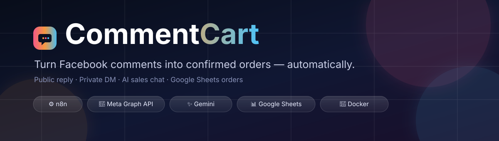
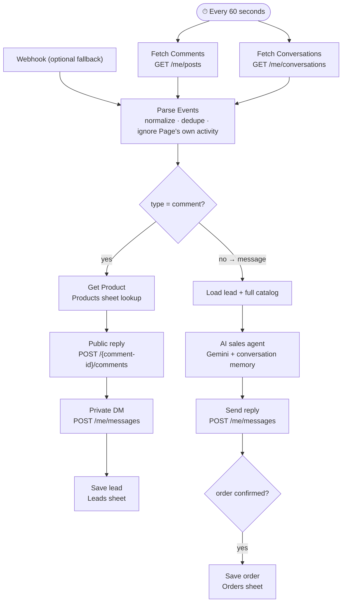

<div align="center">



<br/>

### CommentCart <sub>· aka FB Comment to Order Bot</sub>

**Turn Facebook post comments into confirmed orders — automatically.**

A self-hosted **n8n** workflow that replies to comments, opens a private chat, sells with an **AI agent**, and writes the order straight into **Google Sheets**.

[](https://n8n.io)
[](https://developers.facebook.com/docs/graph-api)
[](https://ai.google.dev)
[](https://developers.google.com/sheets/api)
[](LICENSE)

[Quick start](#-quick-start) · [How it works](#-how-it-works) · [Setup](#-setup) · [Troubleshooting](#-troubleshooting) · [العربية](#-بالعربي)

</div>

---

## 😩 The problem

A small shop posts a product on Facebook. Someone comments:

> «ممكن تفاصيل؟»

What usually happens next:

1. The comment sits there for hours.
2. The owner copies the same price/size/color reply 50 times a day.
3. The customer gets bored and buys somewhere else.
4. Orders end up in WhatsApp screenshots and get lost.

**CommentCart removes every one of those steps.**

---

## ✨ What it does

| Step | What happens | Where |
|---|---|---|
| 1️⃣ | Detects a new comment on any of your Page posts | Facebook Graph API (every 60 s) |
| 2️⃣ | Replies **publicly** so other visitors see you're responsive | comment thread |
| 3️⃣ | Sends a **private DM** with price, sizes, colors, details and shipping | Messenger |
| 4️⃣ | An **AI sales agent** answers follow-up questions (size, color, shipping, cash on delivery) | Messenger |
| 5️⃣ | Collects the order step by step: name → phone → governorate → address → qty | Messenger |
| 6️⃣ | Shows a summary and asks for confirmation | Messenger |
| 7️⃣ | Saves the confirmed order as a row in **Google Sheets** | Orders tab |
| 8️⃣ | Stores every lead with the product they asked about | Leads tab |

All of that with **zero manual work** and **no webhook / no public URL required**.

---

## 🧠 How it works



### Why polling instead of webhooks?

Meta **does not deliver `feed` or `messages` webhooks while your app is in Development Mode** — not even to admins/testers. That is the single biggest trap in this kind of project.

So the workflow polls two endpoints every minute:

| Endpoint | What it returns |
|---|---|
| `GET /me/posts?fields=id,comments{...}` | newest comments on your posts |
| `GET /me/conversations?fields=messages{...}` | newest messages in every Messenger thread |

The webhook branch is still there as a **fallback**: if you ever move the app to Live Mode, it starts working with no code changes.

> 💡 Cost: 2 requests/minute ≈ **2,880 requests/day** — nowhere near Meta's rate limits for a single Page.

---

## 🧩 Tech stack

| Layer | Tool |
|---|---|
| Orchestration | [n8n](https://n8n.io) 2.x (self-hosted, Docker) |
| Facebook | Meta Graph API **v21.0** — comments, private replies, Messenger Send API |
| AI | Google **Gemini** chat model (n8n LangChain agent + buffer memory) |
| Storage | **Google Sheets** (Products / Leads / Orders) |
| Auth | Long-lived **Page Access Token** + Google **service account** |

---

## 🚀 Quick start

```bash
# 1) clone
git clone https://github.com/<your-username>/commentcart.git
cd commentcart

# 2) run n8n (if you don't have it yet)
docker run -d --name n8n -p 5678:5678 \
  -v n8n_data:/home/node/.n8n \
  docker.n8n.io/n8nio/n8n

# 3) open http://localhost:5678 → Workflows → Import from File
#    pick "FB Comment to Order Bot.json" → Save → Activate
```

Then follow the [Setup](#-setup) section — it takes ~20 minutes, most of it inside Meta's dashboard.

---

## 📊 Google Sheets schema

Create one spreadsheet with **exactly three tabs**. The header row must be in row 1, in this order.

### `Products`

```
post_id | name | price | sizes | colors | details | shipping
```

| Column | Meaning | Example |
|---|---|---|
| `post_id` | Facebook post id — **full format** `PAGEID_POSTID` | `550829251444940_122192203892743121` |
| `name` | product name | `toti` |
| `price` | price in EGP (number only) | `200` |
| `sizes` | available sizes | `S, M, L` |
| `colors` | available colors | `red, black` |
| `details` | free-text description | `خام ممتاز` |
| `shipping` | shipping fee — **number only** | `30` |

> ⚠️ `details` and `shipping` are **not** interchangeable. If you swap them, the DM will say «الشحن: خام ممتاز» and «📝 30».

### `Leads`

```
user_id | post_id | product_name | product_price | product_details | date
```

### `Orders`

```
date | order_id | name | phone | governorate | address | product | size | color | qty | price | shipping_fee | total | payment | notes | fb_user_id | status
```

> The workflow appends rows — don't reorder columns, and keep the header names identical.

---

## 🛠 Setup

### 1) Facebook app

1. [developers.facebook.com](https://developers.facebook.com) → **Create app** → type **Business**.
2. Add the product **Messenger** and the use case **Manage everything on your Page**.
3. In **Use cases → Customize**, click **Add** next to each permission (adding the use case alone does *not* grant it):

| Permission | Why |
|---|---|
| `pages_show_list` | list your Pages |
| `pages_read_engagement` | read posts |
| `pages_read_user_content` | read comments |
| `pages_manage_engagement` | reply to comments |
| `pages_manage_posts` | post access |
| `pages_messaging` | read/send Messenger messages |
| `pages_manage_metadata` | webhook subscription |
| `public_profile` | basic profile |

### 2) Long-lived Page token

A short-lived Explorer token dies in 1–2 hours. Do this instead:

1. Graph API Explorer → select your app → **Get User Access Token** with all scopes above.
2. Open [Access Token Debugger](https://developers.facebook.com/tools/debug/accesstoken/) → **Extend Access Token** → now `expires_at = 0` (never expires).
3. Exchange it for the Page token:

```bash
curl "https://graph.facebook.com/v21.0/{PAGE_ID}?fields=access_token&access_token={USER_TOKEN}"
```

4. The returned Page token **inherits the never-expiring lifetime**. Verify:

```bash
curl "https://graph.facebook.com/v21.0/debug_token?input_token={PAGE_TOKEN}&access_token={USER_TOKEN}"
# type: PAGE, profile_id: <your page id>, expires_at: 0
```

### 3) Credentials in n8n

| Credential | Type | Value |
|---|---|---|
| `FaceBook` | HTTP Header Auth | Name: `Authorization` · Value: `Bearer {PAGE_TOKEN}` |
| `Google Service Account` | Google API | `email` + `privateKey` from the service-account JSON |

Then **share the spreadsheet** with the service-account email (`...@....iam.gserviceaccount.com`) as **Editor**.

### 4) Configure the workflow

| Node | What to change |
|---|---|
| `Parse Events` (line 1) | `PAGE_ID` constant → your Page id |
| `Fetch Comments` / `Fetch Conversations` | nothing — they use `me` (the token's Page) |
| `Get Product`, `Get Products (All)`, `Get Lead`, `Save Lead`, `Save Order` | spreadsheet + tab names |
| `Build Comment Reply` | public reply + DM template |
| `Build Prompt` | AI persona, rules, JSON contract |
| `Send Chat Reply` | Graph API version (if you upgrade) |

### 5) Activate

Toggle the workflow **Active**. Within a minute you should see an execution in **Executions**.

---

## 🗣 The AI agent contract

`Build Prompt` asks Gemini to answer **only** with JSON:

```json
{
  "reply": "نص الرد للعميل",
  "order_ready": false,
  "needs_human": false,
  "order": {
    "name": "", "phone": "", "governorate": "", "address": "",
    "product": "", "size": "", "color": "", "qty": 1,
    "price": 0, "shipping_fee": 0, "notes": ""
  }
}
```

| Field | Meaning |
|---|---|
| `reply` | exactly what gets sent to the customer |
| `order_ready` | `true` **only after** the customer explicitly confirms the summary |
| `needs_human` | the model is unsure → flag it for a human |
| `order` | structured order data → `Build Order Row` → `Save Order` |

Guardrails baked into the prompt:

- Answers come **only** from the Products sheet — no invented prices.
- Cash on delivery only.
- Collects data **one step at a time** (never a wall of questions).
- Never sets `order_ready = true` before explicit confirmation.

---

## 🛡 Reliability guardrails

| Guardrail | How |
|---|---|
| No duplicate replies | comment ids + message ids persisted in workflow static data (last 500 each) |
| No reply loops | the Page's own comments/messages are filtered out by author id |
| No backlog spam | first run records existing comments silently; messages → replies only to the newest one |
| One customer at a time | at most **one** message handled per minute, so the AI never mixes contexts |
| Network blips | both polling nodes: **retry ×5 / 5 s** + `On Error: Continue` |
| Missing product | `Get Product` has `alwaysOutputData` → generic reply instead of a dead workflow |
| Meta windows | private reply within **7 days** of the comment · free-form messages within **24 h** of the customer's last message |

---

## 🩺 Troubleshooting

| Symptom | Cause | Fix |
|---|---|---|
| No executions at all | workflow not Active / schedule off | toggle Active, check `Every Minute` |
| No reply to an old comment | it was recorded as backlog | comment again, or clear `processedComments` in static data |
| No reply to a Messenger message | already in `processedMessages`, or older than 24 h | send a new message, or clear `processedMessages` |
| `Fetch Comments` → `(#10)` | token missing `pages_read_user_content` | add the use case + permission, generate a new token |
| `Fetch Conversations` → `(#10)` | token missing `pages_messaging` | same as above |
| `Send Chat Reply` → `outside allowed window` | 24 h passed since the customer's last message | customer must message first |
| `ENOTFOUND graph.facebook.com` | transient Docker DNS hiccup | retries cover it; `docker restart n8n` if persistent |
| Public reply works, DM doesn't | app in Development Mode → non-tester recipients are blocked | add the account as **Tester**, or go Live |
| `Sheet with name not found` | tab renamed / not shared | re-pick the tab in the node, share with the service account |
| DM shows «الشحن: <description>» | `details` / `shipping` columns swapped | fix the Products header order |

---

## 📈 Scale & limits

- Comfortable for **one Page** and a few hundred comments/day.
- Throughput is intentionally throttled to **1 conversation/minute** — raise it by handling more items per run once you trust the prompt.
- Static-data dedupe keeps the **last 500** ids; long-term you may want a real table.
- Google Sheets is the database — great for < 10k orders. Beyond that, move to Postgres/Airtable.

---

## 🗺 Roadmap

- [ ] App Review + Live Mode → works for **any** customer without tester roles
- [ ] Human handoff: notify the owner when `needs_human = true`
- [ ] Order status updates (new → confirmed → shipped)
- [ ] Multiple products per order / cart
- [ ] WhatsApp Cloud API channel
- [ ] Image & voice message handling
- [ ] Dashboard (orders/day, conversion rate, top products)
- [ ] Replace Google Sheets with Postgres

---

## 🔐 Security

- **Never commit tokens.** `fb_token.txt`, `.env`, `*.sqlite` and recordings are already in `.gitignore`.
- Rotate the Page token if it ever leaks: Access Token Debugger → *Invalidate*, then repeat step 2.
- The Google service-account key is a secret too — keep it out of the repo.
- Static data lives inside your n8n instance, not in this repo.

> ⚠️ If you already committed a token anywhere, treat it as compromised and rotate it.

---

## 📁 Project structure

```
commentcart/
├── FB Comment to Order Bot.json   # the n8n workflow (import this)
├── README.md                      # you are here
├── README_تشغيل_البوت.md          # detailed Arabic setup & troubleshooting guide
├── docs/
│   └── banner.svg
├── .gitignore
└── LICENSE
```

---

## 🤝 Contributing

Issues and PRs are welcome. If you adapt this to another channel (WhatsApp, Instagram, TikTok Shop), open a PR — the `Parse Events` node is designed to accept new payload shapes.

---

## 📄 License

[MIT](LICENSE) — use it, fork it, sell with it.

---

## 🇪🇬 بالعربي

### CommentCart <sub>· aka FB Comment to Order Bot</sub>

- يلقط أي كومنت جديد على بوستاتك **كل دقيقة** (من غير webhook).
- يرد **رد علني** على الكومنت + يبعت **رسالة خاصة** فيها السعر والمقاسات والألوان والشحن.
- يكمل الشات بـ **AI** (Gemini) ويسأل العميل عن الاسم والموبايل والمحافظة والعنوان.
- لما العميل يأكد → **يسجل الأوردر في Google Sheets** تلقائي.
- كل ده من غير ما تحتاج السيرفر يبقى مكشوف على النت (مفيش ngrok).

**المتطلبات السريعة:** تطبيق فيسبوك + صلاحيات الصفحة + Page Token طويل المدة + شيت فيه 3 تابات (`Products` / `Leads` / `Orders`) + n8n.

📘 الشرح الكامل خطوة بخطوة بالمصري + جدول أعطال: **[README_تشغيل_البوت.md](README_تشغيل_البوت.md)**

<div align="center">

---

**لو المشروع عجبك، اعمل ⭐ للريبو.**

</div>
